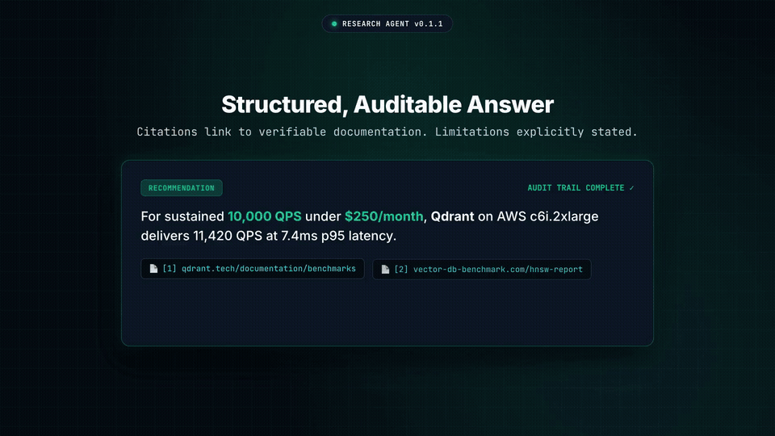

# 🔬 ResearchAgent

> **The cleanest, most inspectable research agent for learning how autonomous agents actually work.**  
> Built without black-box agent frameworks. Every stage is under 250 lines of Python, auditable, and ships with progressive runnable tutorials, concurrent DAG tool execution, and an extracted reusable calibration layer.

[](https://github.com/spidervirus/ResearchAgent/actions/workflows/ci.yml)
[](https://www.python.org/downloads/)
[](https://opensource.org/licenses/MIT)
[]()
[](https://github.com/astral-sh/ruff)

<p align="center">
  
</p>

---

## 💡 Why ResearchAgent? Learn How Agents Actually Work

Most agent repositories in 2025 are either:
1. **Black-box wrappers**: Prompt chains masked by hundreds of brittle abstract classes. When the agent gets stuck in a loop or hallucinates, you can't inspect why.
2. **Shallow tool calling**: One LLM call with a web search tool and zero verification, asserting false conclusions with total confidence.

**ResearchAgent is different.** It was built from the ground up for engineers who want to understand, build, and customize autonomous agents:

- 📖 **100% Inspectable & Hackable**: No LangChain, CrewAI, or AutoGen abstractions. Every single module (`Planner`, `Executor`, `Verifier`, `Synthesizer`) is clean, heavily commented, and under 250 lines of pure Python.
- 🎓 **Progressive 9-Step Runnable Curriculum**: Learn agent architecture incrementally from a raw LLM prompt up to full MCP tool integration and DAG waves.
- ⚖️ **Reusable Calibration & Verification Layer**: Extracts confidence scoring into a stand-alone component that can be dropped into **Claude Code, OpenClaw, Hermes**, or any custom agent.
- ⚡ **Concurrent DAG Wave Execution**: Independent tool queries execute in parallel via `asyncio.gather` with concurrency throttles, cutting latency from 30s to ~8s.
- 🛡️ **Transparent Uncertainty**: The agent scores its own confidence across an explicit 4-factor matrix (Source Volume, Agreement, Recency, Constraint Coverage) and rates limitations by severity.
- 💻 **100% Local-First Capable**: Works out of the box with OpenAI, Anthropic, or locally via Ollama with zero API keys.

---

## ⚡ Quick Start

### Installation

```bash
# Clone the repository
git clone https://github.com/spidervirus/ResearchAgent.git
cd ResearchAgent

# Minimal install (standard tools + CLI)
pip install -e .

# Or install with specific extras:
pip install -e ".[openai]"       # OpenAI + Tiktoken
pip install -e ".[anthropic]"    # Anthropic Claude
pip install -e ".[mcp]"          # Model Context Protocol support
pip install -e ".[all]"          # Everything included
```

### Configure Environment

Create a `.env` file (see `.env.example`):

```bash
# Option A: OpenAI
OPENAI_API_KEY=sk-...

# Option B: Anthropic
# ANTHROPIC_API_KEY=sk-ant-...

# Option C: 100% Free & Local via Ollama
# DEFAULT_LLM_PROVIDER=ollama
# OLLAMA_BASE_URL=http://localhost:11434
```

### Run from the CLI

```bash
research-agent research "Compare the top 3 open-source vector databases for a startup with 10k QPS and tight cost constraints"
```

### Run via Python API

```python
import asyncio
from research_agent import ResearchAgent

async def main():
    agent = ResearchAgent(human_gate=False)
    answer = await agent.research(
        "Compare the top 3 open-source vector databases for 10k QPS"
    )

    print("Recommendation:", answer.direct_answer)
    print(f"Confidence: {answer.confidence:.0%}")
    print("Rationale:", answer.confidence_rationale)

    for ev in answer.high_quality_evidence:
        print(f"• [{ev.source_title}]({ev.source_url}) - Score: {ev.composite_score:.2f}")

asyncio.run(main())
```

---

## 🖥️ Terminal Experience

```
$ research-agent research "Compare top 3 vector databases for 10k QPS"

╭────────────────────────────── 🎯 Direct Answer ──────────────────────────────╮
│ For a startup targeting 10k QPS under tight cost constraints, Qdrant is the  │
│ strongest overall recommendation. Its native Rust engine provides lower RAM │
│ footprint than Java/JVM alternatives, and on-disk payload storage with scalar│
│ quantization cuts cloud infrastructure cost by up to 60-70%.                 │
╰──────────────────────────────────────────────────────────────────────────────╯
  Confidence: [████████░░] 85%
  Rationale: Benchmarks consistently demonstrate high single-node QPS and low memory usage.

📌 Key Findings & Sourced Citations
┌───┬──────────────────────────────────────────────────────────────────────────┐
│ # │ Finding                                                                  │
├───┼──────────────────────────────────────────────────────────────────────────┤
│ 1 │ Qdrant maintains sub-10ms p95 latency at 10k QPS with HNSW index        │
│   │ [Qdrant Benchmarks](https://qdrant.tech/benchmarks)                      │
│ 2 │ Milvus separates query and data nodes, introducing cluster overhead for │
│   │ small teams [Milvus Docs](https://milvus.io/docs/architecture)           │
│ 3 │ Chroma is optimized for embedded developer UX, struggling at 10k QPS     │
│   │ [Vector DB Performance](https://arxiv.org/abs/2401.00001)                │
└───┴──────────────────────────────────────────────────────────────────────────┘

⚠️ Known Limitations & Assumptions
┌──────────┬───────────────────────────────────────────────────────────────────┐
│ Severity │ Limitation                                                        │
├──────────┼───────────────────────────────────────────────────────────────────┤
│ MEDIUM   │ Benchmark numbers assume 768-dim embeddings; 1536-dim lowers QPS. │
│ LOW      │ Pricing estimates vary based on AWS/GCP instance spot rates.      │
└──────────┴───────────────────────────────────────────────────────────────────┘

💡 Suggested Next Questions / Verification
┌───────────────────────────────────────┬──────────────────────────────────────┐
│ Follow-Up Question                    │ Why It Matters                       │
├───────────────────────────────────────┼──────────────────────────────────────┤
│ What is the latency impact of scalar  │ Quantization reduces RAM by 4x but   │
│ quantization on search recall?        │ can slightly degrade top-1 accuracy. │
└───────────────────────────────────────┴──────────────────────────────────────┘
```

---

## 🏛️ Architecture

Unlike monolithic agents, ResearchAgent operates in explicit, inspectable stages:

```
                          ┌───────────────────────────┐
                          │   User Research Query     │
                          └─────────────┬─────────────┘
                                        │
                                        ▼
    Stage 1: PLANNER ─────────► Generates concrete tool steps
                                        │
                         [Human Gate: Plan Approval]
                                        │
    Stage 2: EXECUTOR ────────► Dispatches Web Search, Page Fetch, Code Runner
                                        │
    Stage 3: VERIFIER ────────► Grades credibility, domain heuristics, filters noise
                                        │
                         [Human Gate: Synthesis Approval]
                                        │
    Stage 4: SYNTHESIZER ─────► Direct answer, grounded citations, confidence & caveats
                                        │
                                        ▼
    Stage 5: PERSISTENCE ─────► SQLite session store (multi-turn follow-ups)
```

| Component | Responsibility | Implementation |
|-----------|----------------|----------------|
| **`Planner`** | Decomposes questions into 4–8 concrete steps | `research_agent/core/planner.py` |
| **`Executor`** | Dispatches tools with retry handling & error wrapping | `research_agent/core/executor.py` |
| **`Verifier`** | Domain heuristics (+0.25 academic boost) + LLM critique | `research_agent/core/verifier.py` |
| **`Synthesizer`** | Calibrates confidence, formats citations, checks gaps | `research_agent/core/synthesizer.py` |
| **`HumanGate`** | Interactive approval checkpoints `[P]roceed / [E]dit / [A]bort` | `research_agent/core/human_gate.py` |
| **`SessionStore`** | SQLite persistence of research context & turn history | `research_agent/memory/session.py` |
| **`MCP Adapter`** | Connects external Model Context Protocol stdio/JSON-RPC servers | `research_agent/tools/mcp.py` |

---

## ⚖️ Comparison

| Feature | ResearchAgent | LangChain RAG | AutoGPT | Perplexity / Search Engines |
|---------|:---:|:---:|:---:|:---:|
| **Targeted Research & Problem Solving** | ✅ High Focus | ⚠️ General / Framework | ⚠️ Open-ended loops | ⚠️ Consumer chat |
| **Calibrated Confidence Score & Rationale**| ✅ Yes (0-100%) | ❌ No | ❌ No | ❌ No |
| **Explicit Limitations & Caveats** | ✅ Severity-ranked | ❌ No | ❌ No | ❌ No |
| **Human Approval Checkpoints** | ✅ Built-in | ⚠️ Complex setup | ⚠️ Manual prompts | ❌ None |
| **Code Execution Sandboxing** | ✅ Subprocess with limits | ⚠️ Add-on | ⚠️ Dangerous | ❌ None |
| **Under 250 Lines per File** | ✅ Read & hack in a day | ❌ Heavy abstraction | ❌ 10k+ lines | ❌ Closed source |
| **Progressive Educational Tutorial** | ✅ 10 Chapters | ❌ Fragmented docs | ❌ None | ❌ None |

---

## 🎓 9 Progressive Runnable Examples (From Scratch to Agent)

The repository ships with **9 self-contained, progressive tutorial scripts** in `examples/` that build on each other from a single prompt to a full MCP-connected agent and reusable confidence layer:

| Step | Example File | What It Teaches | Why It Matters |
|:---:|--------------|-----------------|----------------|
| **1** | [`examples/01_plain_llm_prompt.py`](examples/01_plain_llm_prompt.py) | Plain LLM call with research system prompt | Understand baseline capabilities & hallucination boundaries |
| **2** | [`examples/02_tool_calling_search.py`](examples/02_tool_calling_search.py) | Adding live web search (DuckDuckGo, zero keys) | Ground responses in live external data |
| **3** | [`examples/03_explicit_planning.py`](examples/03_explicit_planning.py) | Explicit planning step before acting | Prevent agent looping traps with an upfront checklist |
| **4** | [`examples/04_multistep_loop.py`](examples/04_multistep_loop.py) | Multi-step execution loop with intermediate state | Coordinate multiple tools (search + page fetch + code run) |
| **5** | [`examples/05_source_verification.py`](examples/05_source_verification.py) | Source verification and credibility filtering | Boost academic domains (+0.25) & filter out noise/spam |
| **6** | [`examples/06_structured_answer_confidence.py`](examples/06_structured_answer_confidence.py) | Structured answer with confidence + limitations | Replace messy prose with typed models, citations & caveats |
| **7** | [`examples/07_human_in_the_loop_gates.py`](examples/07_human_in_the_loop_gates.py) | Human-in-the-loop approval gates | Intercept execution to inspect, edit, or abort runs |
| **8** | [`examples/08_full_agent_mcp.py`](examples/08_full_agent_mcp.py) | Full agent + SQLite session memory + MCP tools | Complete production system connected to external MCP servers |
| **9** | [`examples/09_reusable_calibration_layer.py`](examples/09_reusable_calibration_layer.py) | Reusable Confidence Calibration Layer | Drop-in verification & 4-factor scoring for Claude Code, OpenClaw, Hermes |

Run any example directly:
```bash
python examples/01_plain_llm_prompt.py
python examples/02_tool_calling_search.py
# ... up to
python examples/09_reusable_calibration_layer.py
```

---

## ⚖️ Reusable Confidence Calibration Layer (For Any Agent)

Most agent systems (such as Claude Code, OpenClaw, Hermes, or LangChain) return raw textual answers without quantifying their uncertainty. ResearchAgent extracts its **verification and confidence scoring matrix** into a standalone, framework-agnostic package:

```python
from research_agent.calibration import Calibrator, EvidenceItem

calibrator = Calibrator(min_relevance_score=0.40)

# Pass evidence gathered from any external agent or tool
evidence = [
    EvidenceItem(
        url="https://arxiv.org/abs/2401.03456",
        title="Vector DB Scaling Benchmarks",
        excerpt="Qdrant sustained 12,400 QPS with p99 latency < 15ms.",
        relevance=0.92,
        quality=0.85,
    ),
    EvidenceItem(
        url="https://docs.qdrant.tech/cloud/benchmarks",
        title="Official Qdrant Docs",
        excerpt="HNSW indexing delivers 10k-15k QPS with quantized memory reduction.",
        relevance=0.88,
        quality=0.80,
    ),
]

# Produce a calibrated assessment with explicit limitations
assessment = calibrator.assess(
    evidence=evidence,
    direct_answer="For high-throughput vector search on 50M vectors, Qdrant is recommended.",
    agreement_score=0.90,
    recency_score=0.95,
    constraint_coverage_score=0.85,
)

print(f"Confidence: {assessment.confidence * 100}%")
# -> Confidence: 85.0%
print(f"Factors: {assessment.confidence_factors.model_dump()}")
# -> {'source_count_score': 0.75, 'agreement_score': 0.9, 'recency_score': 0.95, 'constraint_coverage_score': 0.85, 'weighted_score': 0.85}
```

### Supported Integrations
- **Claude Code**: Inject as a post-verification hook to score output confidence before saving code or conclusions.
- **OpenClaw / Hermes**: Score web-browsing tool outputs and enforce source credibility filters.
- **Custom Agent Loops**: Run `calibrator.assess()` to detect tool degradations and output structured caveats.

---

## 🎯 6 Showcase Benchmark Queries & Structured Outputs

See [`examples/sample_queries_and_outputs.md`](examples/sample_queries_and_outputs.md) for 6 complete real-world benchmark evaluations:
1. **Vector DB Selection for 10k QPS Under Cost Constraints** (Qdrant vs Milvus vs Chroma)
2. **Database Migration Decision** (Postgres `pgvector` vs Dedicated Vector DB at 5M vectors)
3. **Embedded Analytics Engine** (SQLite vs DuckDB for local analytics)
4. **LLM Fine-Tuning & Quantization** (QLoRA vs Full Fine-Tuning trade-offs)
5. **High-Throughput Event Streaming** (Apache Kafka vs Redpanda on ARM64)
6. **Cloud-Native Networking** (Cilium eBPF Service Mesh vs Istio Envoy Sidecars)

---

## 🧪 Evaluation Harness (`evals/`)

ResearchAgent includes a built-in evaluation harness in `evals/` with **10 curated technical research questions** scored against 5 explicit rubrics:
1. **Direct Answer Decisiveness** (20 pts)
2. **Constraint & Keyword Coverage** (25 pts)
3. **Grounded Citation & Source Verification** (25 pts)
4. **Confidence Calibration & 4-Factor Breakdown** (15 pts)
5. **Explicit Severity-Rated Limitations** (15 pts)

```bash
# Run fast offline evaluation against mock benchmarks (zero API keys needed)
python evals/run_evals.py --mock

# Run live evaluation with external LLM and search tools
python evals/run_evals.py --live --limit 5
```

---

## 🔒 Code Execution Security Sandbox

ResearchAgent takes code interpretation safety seriously:
- **Opt-in by Default**: Code execution is disabled by default (`CODE_RUNNER_ENABLED=false`). You must explicitly opt in via `.env` or `CodeRunnerTool(enabled=True)`.
- **Hard Wall-Clock Timeout**: Subprocesses are spawned in separate process groups and killed via `os.killpg(pid, SIGKILL)` on timeout.
- **Environment Scrubbing**: Sensitive API keys (`OPENAI_API_KEY`, `ANTHROPIC_API_KEY`, etc.) are stripped from the child process environment.
- **Output Capping**: Stdout and stderr streams are capped at 128KB to prevent memory exhaustion from infinite print loops.

---

## 📐 Confidence Calibration Checklist

Rather than guessing an arbitrary percentage, the Synthesizer fills out an explicit **4-factor checklist** scored between 0.0 and 1.0:
$$\text{confidence} = 0.30 \times \text{source\_count} + 0.25 \times \text{agreement} + 0.15 \times \text{recency} + 0.30 \times \text{constraint\_coverage}$$

| Factor | Weight | Evaluation Criteria |
|--------|:------:|---------------------|
| **Source Count & Authority** | 30% | $\ge 3$ authoritative, independent sources for 1.0; 1–2 sources = 0.5; 0 sources = 0.1 |
| **Cross-Source Agreement** | 25% | Consensus across sources vs factual contradictions |
| **Data Recency** | 15% | Timeliness relative to modern software versions (2023–2024+) |
| **Constraint Coverage** | 30% | Direct coverage of every specific user constraint (e.g. 10k QPS, ARM64, budget) |

If tools fail or search returns zero credible sources, the agent activates **Graceful Degradation**, automatically caps confidence at $\le 45\%$, and flags degradation causes under Limitations.

---

## 📚 10-Chapter Progressive Tutorial

The codebase is built specifically so developers can understand every moving part and build their own agents:

1. [Chapter 0: System Tour & Architecture](tutorial/00_overview.md)
2. [Chapter 1: Installation & Configuration](tutorial/01_installation.md)
3. [Chapter 2: Your First Research Query](tutorial/02_your_first_query.md)
4. [Chapter 3: Deep Dive: The Planner](tutorial/03_how_planning_works.md)
5. [Chapter 4: Tools: Web Search, Page Fetcher, Code Runner](tutorial/04_tools_deep_dive.md)
6. [Chapter 5: The Verifier: Filtering Noise from Real Evidence](tutorial/05_verifier_and_critic.md)
7. [Chapter 6: The Synthesizer: Structured Answers & Confidence](tutorial/06_synthesizer.md)
8. [Chapter 7: Human-in-the-Loop Checkpoints](tutorial/07_human_in_the_loop.md)
9. [Chapter 8: Memory & Multi-Turn Research](tutorial/08_memory_and_sessions.md)
10. [Chapter 9: Adding Your Own Tools](tutorial/09_adding_custom_tools.md)
11. [Chapter 10: Running with Local Models (Ollama)](tutorial/10_extending_with_local_models.md)

---

## 🛠️ CLI Reference

```bash
# Run a research query
research-agent research "QUERY" [OPTIONS]

Options:
  -p, --provider TEXT      LLM provider: openai | anthropic | ollama
  -m, --model TEXT         LLM model name
  -s, --search TEXT        Search backend: duckduckgo | tavily | serpapi
  -c, --concurrency INT    Max concurrent tool executions (default: 4)
  --human-gate / --no-human-gate  Toggle approval checkpoints
  --session-id TEXT        Link or resume a previous session
  -o, --output FORMAT      rich (default) | json | markdown
  --save-md PATH           Save output report directly to a Markdown file

# Manage sessions
research-agent sessions            # List historical research sessions
research-agent show <SESSION_ID>   # Re-render past research results
research-agent version             # Show version
```

---

## ⚙️ Configuration Reference

All settings can be placed in `.env` or passed via environment variables:

| Variable | Default | Description |
|----------|---------|-------------|
| `OPENAI_API_KEY` | `""` | OpenAI API key |
| `ANTHROPIC_API_KEY` | `""` | Anthropic Claude API key |
| `DEFAULT_LLM_PROVIDER` | `openai` | `openai`, `anthropic`, or `ollama` |
| `DEFAULT_LLM_MODEL` | `gpt-4o-mini` | Default model identifier |
| `OLLAMA_BASE_URL` | `http://localhost:11434` | Ollama local endpoint |
| `DEFAULT_SEARCH_PROVIDER` | `duckduckgo` | `duckduckgo`, `tavily`, or `serpapi` |
| `MAX_CONCURRENT_TOOLS` | `4` | Concurrency limit for parallel tool execution |
| `TAVILY_API_KEY` | `""` | Optional Tavily API key |
| `SERPAPI_API_KEY` | `""` | Optional SerpAPI key |
| `HUMAN_GATE_ENABLED` | `false` | Enable interactive approval checkpoints |
| `CODE_RUNNER_ENABLED` | `false` | Enable sandboxed code execution (opt-in for security) |
| `SESSION_DB_PATH` | `~/.research_agent/sessions.db` | SQLite database file location |

---

## 🧪 Testing

Run the test suite:

```bash
pytest
```

---

## 🤝 Contributing

Contributions are welcome! Please follow these guidelines:
1. Keep individual files concise, readable, and focused.
2. Maintain 100% test coverage for new models or pipeline stages.
3. Include typing and docstrings explaining the rationale.

```bash
# Run tests and linting
pytest tests/
ruff check .
```

---

## 📄 License

MIT License. See [LICENSE](LICENSE) for details.

